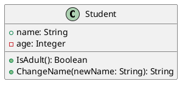

# xtUML to Go Compiler (Python GUI)

An educational compiler project that translates a documented subset of UML/xtUML class models and simple state machines into Go source code.

## Run
Requires Python 3.10+ with Tkinter.

```bash
python main.py
```

No third-party runtime packages are required.

## Run tests
From the project root:

```bash
python -m unittest discover -s tests -v
```

## Compiler pipeline
1. **Lexer** (`xtuml_go/lexer.py`) tokenizes identifiers, symbols, directives and line breaks.
2. **Parser** (`xtuml_go/parser.py`) performs recursive-descent parsing and creates an IR.
3. **IR** (`xtuml_go/model.py`) stores classes, attributes, operations, inheritance, states and transitions.
4. **Semantic analysis** (`xtuml_go/semantic.py`) checks duplicate classes/members, parent references, inheritance cycles, identifiers, and state machine consistency.
5. **Code generation** (`xtuml_go/codegen.py`) emits Go structs, constructors, method stubs, and state-machine transition scaffolding.
6. **GUI** (`xtuml_go/gui.py`) supports loading/editing source, compiling, viewing diagnostics, and saving `.go`.

## Supported class syntax



- `+` public -> exported Go identifier
- `-` private -> unexported Go identifier
- `#` and `~` are currently treated as non-public
- `class Child extends Parent { ... }` supports basic struct embedding for inheritance-like composition
- Types: `String`, `Integer`, `Boolean`, `Float`, `Double`, `Long`, `Date`, `List<Type>`, `Type[]`, `Optional<Type>`, and custom Go type names

## Supported association DSL

Declare classes first, then use:

```text
association Student courses Course many
association Student advisor Teacher optional
association Order invoice Invoice one
```

- `one` -> one target value (`Target`)
- `optional` -> pointer to target (`*Target`)
- `many` -> slice (`[]Target`), initialized to an empty slice in the constructor

This explicit DSL is used instead of attempting to parse every possible PlantUML association notation.

## Supported state machine DSL

Declare the owner class before the state machine:

```text
class Order {
  +id: String
}
state_machine OrderLifecycle for Order {
  initial Pending
  state Pending
  state Paid
  transition Pending on Pay -> Paid action MarkPaid
}
```

Generated Go contains state constants and a transition handler scaffold. **Important:** the current version does not persist runtime state or execute action bodies. It generates scaffolding and TODO comments, not complete behavioral semantics.

## Example workflow
1. Launch the GUI.
2. Click **Load example** or **Open UML**.
3. Edit the source model.
4. Click **Compile**.
5. Read errors/warnings in the diagnostics panel.
6. Save generated code with **Save Go**.

## Current limitations
- This is a compiler for a documented subset, not a complete implementation of the xtUML standard.
- It does not read native xtUML project databases/models or every PlantUML construct.
- Associations support the explicit `association Source field Target one|optional|many` DSL; full PlantUML association syntax and inverse navigation are not implemented.
- State-machine transitions update stored runtime state; state-machine actions are still comments/TODOs and require user implementation.
- Constructors use all declared attributes as arguments; defaults are not yet applied.
- Generated code can require user-written action logic, custom type declarations, or further project-level integration.

## Recommended future extensions
- Generate persistent state fields and executable transition logic.
- Add association and multiplicity mapping.
- Improve Go identifier collision checks and use `gofmt`.
- Add source mapping / line diagnostics and compilation report export.
- Add model-based tests for state transition coverage.

## UI Theme

The desktop interface uses the Color Hunt-inspired palette:
- Deep Navy `#0C2C55` for the header and identity
- Teal `#296374` for primary actions
- Soft Cyan `#629FAF` for accents and status indicators
- Warm Ivory `#EDEEDC` for the application background

Compiler success, error, and save notifications use custom themed dialogs. The source editor remains dark and the generated Go panel remains light for contrast.
